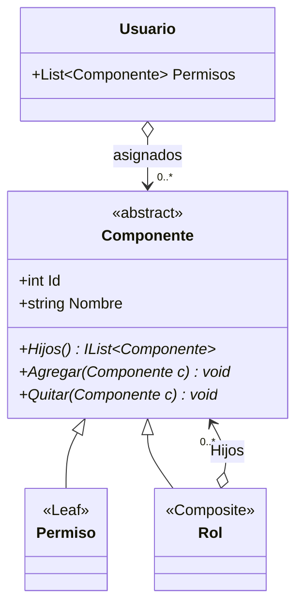
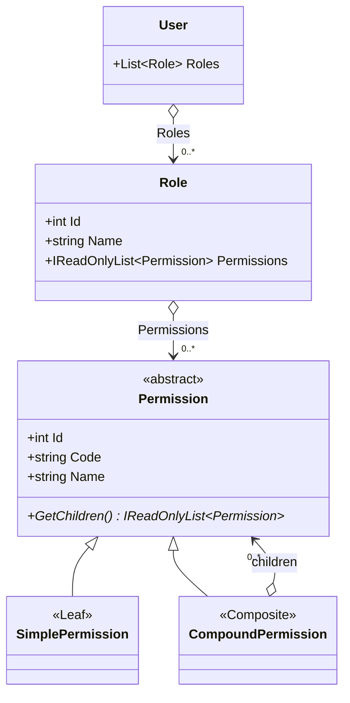

# DC - Modelo I vs Modelo II de roles y permisos

El boceto de la cátedra (`Entrega_2/roles_y_permisos_2_formas.jpeg`) propone dos
formas de modelar roles y permisos. **El proyecto implementa el Modelo I** (se
migró desde el Modelo II para pasar de 5 tablas a 3 sin perder el Composite). Este
documento deja registrado cómo se diferencian y qué se tocó en la migración.

En el Modelo I implementado, la clase `Componente` del boceto es `Permission`, la
`Familia`/rol es `CompoundPermission` y el flag que distingue un rol de una
familia común es `IsRol`; `IsFamily` distingue hoja de compuesto. Los permisos
simples (hojas) siguen siendo un catálogo fijo, sin ABM.

## Modelo I - un solo Componente (Rol = permiso compuesto)

Todo es un `Componente`: el rol es sólo una agrupación más. El usuario se asocia
directamente a componentes.

Es el modelo del ejemplo de la cátedra (`Familia`/`Patente`) y de la pantalla de
referencia: *ROLES (Familias)* y *PERMISOS SIMPLES (Patentes)* en un mismo
catálogo, con un botón *Crear Rol Anidado* (un rol dentro de otro).

## Modelo II - Rol separado (el anterior, descartado)

El rol **no** es parte del Composite. El Composite vive sólo entre permisos
(simple / compuesto) y el rol los agrega.

## Comparación

| Aspecto | Modelo I (implementado) | Modelo II (anterior) |
|---|---|---|
| Tipos | `Componente` → `Permiso`, `Rol` | `Permission` → `SimplePermission`, `CompoundPermission`; `Role` aparte |
| ¿Qué es un rol? | Un composite más | Entidad propia que agrega permisos |
| Permiso complejo vs rol | **No se distinguen** estructuralmente | Se distinguen: el compuesto agrupa permisos, el rol se asigna a usuarios |
| Rol dentro de rol (anidado) | Sí, naturalmente | No (se logra con un permiso compuesto compartido) |
| Usuario se asocia a | Cualquier componente (rol o permiso suelto) | Sólo roles |
| ABM | Crear/borrar roles = crear/borrar composites | ABM de `Role`; el catálogo de permisos es fijo |
| Tablas | `Permiso` (con `EsFamilia`), `Permiso_Permiso`, `Usuario_Permiso` | `Permission`, `Permission_Permission`, `Role`, `Role_Permission`, `User_Role` |
| Verificación | `usuario.Componentes.Any(c => c.Tiene(x))` | `usuario.Roles.Any(r => r.Grants(x))` (un nivel más) |
| Riesgo | Se puede asignar un permiso suelto a un usuario y se pierde el concepto de rol | Más tablas y una clase más |

## Qué se cambió en la migración al Modelo I

1. **Entidades (BE)**: se eliminó `Role` y `RoleMapper`. `Permission` ganó `IsRol`
   y `IsCompound` pasó a llamarse `IsFamily`. `User.Roles` pasó a
   `User.Permissions : List<Permission>` (`User.Roles` queda como vista de los
   que tienen `IsRol`) y `HasPermission` itera sobre ella.
2. **SQL** (`04_init_create_roles_permission.sql`): `Role`, `Role_Permission` y
   `User_Role` desaparecen; los roles son filas de `[Permission]` con
   `IsFamily = 1` e `IsRol = 1` (`Code = ROL_<NOMBRE>`), sus hijos van a
   `[Permission_Permission]` y `[User_Role]` se reemplaza por `[User_Permission]`.
   El script migra una base del Modelo II sin perder datos.
3. **DAL**: `RoleDAL` consulta `[Permission]` filtrando `IsRol`;
   `PermissionDAL.FillChildren` no cambió. `RoleDAL.Delete` sólo borra filas con
   `IsRol = 1`: las hojas no tienen ABM.
4. **BLL**: `RoleBLL` conserva sus operaciones pero opera sobre `Permission`;
   rechaza lo que no sea rol (`msg.role.notRole`) y valida ciclos de rol anidado
   (`msg.role.cycle`).
5. **UI**: `FrmRoleManagement` usa `Permission` con `IsRol` como rol; un rol del
   catálogo se puede asignar a otro rol con *Asignar Permiso a Rol* (rol anidado).
6. **Tests**: `HasPermission`, `Flatten` y la BLL siguen valiendo; se agregaron
   casos de rol anidado, ciclo, borrado de hoja y asignación de no-rol.

## Diagramas relacionados

- Clases (Modelo II): [DC-permisos-composite.md](DC-permisos-composite.md)
- Datos: [DER-permisos-composite.md](../DER%20-%20Diagrama%20entidad%20relación/DER-permisos-composite.md)
