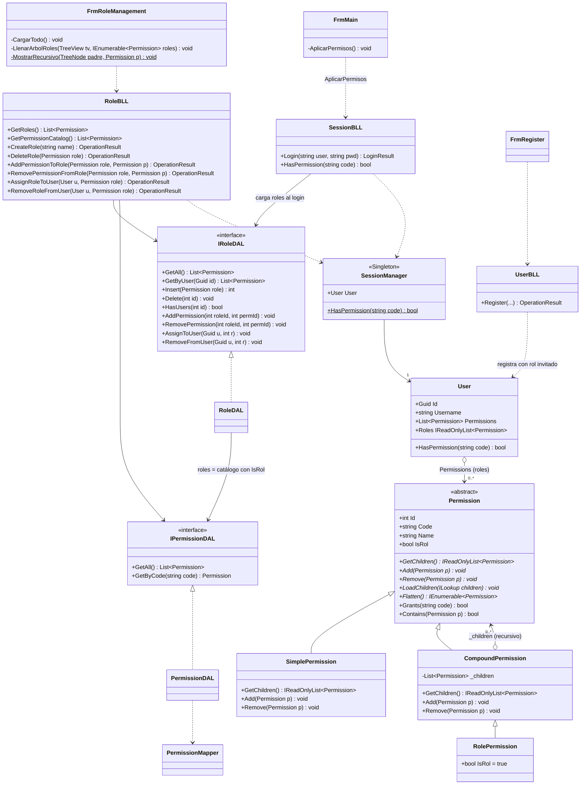

# DC - Diagrama de clases: Perfiles de usuario (T04, patrón Composite)

## Objetivo

Que cada usuario tenga uno o más **roles** y que cada rol otorgue **permisos**
simples o compuestos, de modo que el sistema pueda (a) decidir qué opciones
mostrar y ejecutar, y (b) mostrar el árbol de permisos en un `TreeView` mediante
funciones recursivas. Se implementa el **Modelo I**: un rol es un permiso
compuesto marcado con `IsRol` (no hay clase ni tabla `Role`). El Modelo II
(rol separado) quedó como alternativa descartada en
[DC-modelo-I-vs-II-permisos.md](DC-modelo-I-vs-II-permisos.md).

## Aplicación del patrón

| Rol en el patrón | Clase (`BE.Entity`) | Qué es en el dominio |
|---|---|---|
| *Component* | `Permission` (abstracta) | Un permiso genérico (simple o familia) |
| *Leaf* | `SimplePermission` | Permiso atómico sobre una acción (ej. `GESTIONAR_ROLES`) |
| *Composite* | `CompoundPermission` | Agrupa permisos simples y/u otros compuestos (ej. `SESION_BASICA`) |
| *Composite* (rol) | `RolePermission` (subclase de `CompoundPermission`) | Familia que se asigna a usuarios (ej. `administrador`) |
| *Client* | `User`, `SessionManager`, `FrmRoleManagement` | Tratan igual a un permiso simple y a uno compuesto |

El rol **es** parte del Composite: es una subclase (`RolePermission`, `IsRol = true`), por lo
que un rol puede contener otro rol (rol anidado). Un `User` tiene N permisos
asignados (sólo roles, validado en la BLL).

> Equivalencia con los nombres del ejemplo de la cátedra: `ComponentePermiso` →
> `Permission`, `PatenteBE` → `SimplePermission`, `FamiliaBE` →
> `CompoundPermission`, `AgregarHijo/RemoverHijo/ObtenerHijos` →
> `Add/Remove/GetChildren`. La clase `Familia` del ejemplo hacía de rol *y* de
> agrupación; acá vuelven a unirse: `RolePermission` es un `CompoundPermission`.

## Diagrama de clases



## Algoritmos recursivos

**Verificación (corta en el primer match)** — `Permission.Grants`:

```csharp
public bool Grants(string code)
{
    if (Code == code) return true;                 // este nodo (hoja o compuesto)
    foreach (var child in GetChildren())           // hoja: lista vacía, corta la recursión
        if (child.Grants(code)) return true;
    return false;
}
// Un rol es un compuesto: role.Grants(code) ya recorre sus hijos.
// User.HasPermission => Permissions.Any(p => p.Grants(code))
```

**Armado del árbol en memoria** — `PermissionDAL.GetAll`: se leen `[Permission]` y
`[Permission_Permission]`, se arma un `ILookup` padre → hijos y se llama
`LoadChildren` sobre **todo** el catálogo, sin preguntar el tipo: la hoja ignora la
llamada y el compuesto agrega los suyos. El único punto que decide la clase es
`PermissionMapper` (tabla `(IsFamily, IsRol)` → clase, sin `if`).

**Presentación en `TreeView`** — `FrmRoleManagement.MostrarRecursivo`:

```csharp
private static void MostrarRecursivo(TreeNode nodoPadre, Permission permiso)
{
    var nodo = new TreeNode(permiso.Name) { Tag = permiso };
    nodoPadre.Nodes.Add(nodo);
    foreach (var hijo in permiso.GetChildren())    // el Leaf no tiene hijos
        MostrarRecursivo(nodo, hijo);
}
```

**Aplanado para la bitácora** — `Permission.Flatten` devuelve sólo las hojas;
`BitacoraManager.AplanarRolesPermisos` lo usa para completar
`Bitacora.RolesPermisos` ("Roles: client | Permisos: VER_MI_PERFIL, ...").

## Reglas de negocio

- **Los permisos simples (hojas) no tienen ABM**: son un catálogo fijo sembrado con
  `sql/04_init_create_roles_permission.sql`. La aplicación sólo da de alta, baja y
  modifica **roles** (`IsRol = 1`) y agrega o quita sus hijos. `RoleDAL.Delete`
  filtra por `IsRol = 1` y `RoleBLL` rechaza operar sobre algo que no sea rol.
- Un rol no se elimina si tiene usuarios asignados ni si es `invitado`.
- No se puede agregar a un rol un permiso que ya otorga (directo o por un
  compuesto), ni quitar uno que no esté asignado directamente.
- Un rol puede contener otro rol (rol anidado); los ciclos se rechazan
  (`msg.role.cycle`) antes de persistir.
- Sólo se asignan a usuarios permisos con `IsRol` (`msg.role.notRole`).
- Un administrador no puede quitarse a sí mismo un rol que otorga `GESTIONAR_ROLES`.
- Todo usuario que se registra recibe el rol `invitado` (sólo *Mi perfil* y *Cerrar sesión*).
- Cada operación valida el permiso en la **BLL** (no sólo oculta el menú) y deja
  rastro en bitácora; un intento sin permiso queda como `AccesoNoAutorizado`.

## Notas de diseño

- `SimplePermission.Add/Remove` lanzan `InvalidOperationException` (variante
  *seguridad* del Composite) en lugar de ignorar la llamada: es un error de
  programación intentar colgar hijos de una hoja.
- `CompoundPermission.GetChildren()` devuelve una vista de sólo lectura para que
  nadie altere la colección sin pasar por `Add/Remove`; `Add` rechaza duplicados
  y **ciclos** (un compuesto no puede contenerse a sí mismo, directa o indirectamente).
- Limitación conocida: si un administrador cambia los roles del usuario que tiene
  la sesión abierta, el cambio se ve en su próximo inicio de sesión (los roles
  se cargan una vez, en `SessionBLL.Login`).

## Diagramas relacionados

- Datos: [DER-permisos-composite.md](../DER%20-%20Diagrama%20entidad%20relación/DER-permisos-composite.md)
- Secuencia: [DS-permisos-composite.md](../DS%20-%20Diagramas%20de%20secuencia/DS-permisos-composite.md)
- Casos de uso: [CU-gestion-perfiles.md](../CU%20-%20Casos%20de%20uso/CU-gestion-perfiles.md)
- Alternativa: [DC-modelo-I-vs-II-permisos.md](DC-modelo-I-vs-II-permisos.md)
