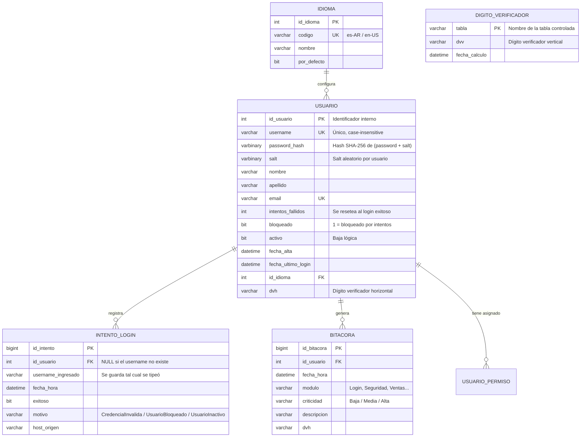

# DER - Login / Autenticación

Modelo de datos que soporta el Caso de Uso **Login**: credenciales, control de
intentos fallidos, bloqueo de usuario y trazabilidad (bitácora).

- La contraseña **nunca** se guarda en claro: se persiste `password_hash` + `salt`
  (calculados por `EncriptadorService`).
- `intentos_fallidos` y `bloqueado` implementan la política de bloqueo por
  N intentos erróneos consecutivos.
- `dvh` (dígito verificador horizontal) por registro y `DIGITO_VERIFICADOR`
  (vertical) por tabla dan integridad ante modificaciones fuera del sistema.

## Reglas de integridad

| Regla | Implementación |
|---|---|
| Un username no se repite | `UNIQUE (username)` |
| No se guarda la contraseña en claro | Sólo `password_hash` + `salt` |
| Bloqueo automático | `intentos_fallidos >= 3` ⇒ `bloqueado = 1` |
| Reset de intentos | Login exitoso ⇒ `intentos_fallidos = 0` |
| Todo intento queda registrado | Insert en `INTENTO_LOGIN` (exitoso o no) |

> `USUARIO_PERMISO` se detalla en [DER-permisos-composite.md](DER-permisos-composite.md).

## T07 - Dígitos verificadores (implementado)

Tablas protegidas: `UserHistory` y `User_Permission` (columna `DVH CHAR(64)`), más la tabla de control:

| DigitoVerificador | Tipo | |
|---|---|---|
| Tabla | NVARCHAR(100) | PK |
| DVV | CHAR(64) | SHA-256 de la tabla |
| FechaCalculo | DATETIME2 | no entra al hash |

Algoritmo (`Services.DigitoVerificador`, UTF-16LE):

- `DVH = SHA256(Tabla | i:longitud:valor | i:N ...)`, con `i` = posición del atributo.
- `DVV = SHA256(Tabla | N | clave=DVH ...)`, ordenado por clave.

### Cómo proteger una tabla nueva

1. `ALTER TABLE [Tabla] ADD DVH CHAR(64) NULL` (en un script nuevo, o junto al 07).
2. Agregar `new EntidadVerificable("Tabla", clave, atributos)` en `BE.Entity.EntidadesVerificables.Todas`.
3. En la DAL de la tabla, hacer las escrituras con `DigitoVerificadorDAL.Escribir(...)` (ver `UserHistoryDAL.Insert`).
4. Agregar un bloque para la tabla en `sql/08_seed_digitos_verificadores.sql` y correrlo una vez.
5. Agregar la entidad a `IntegridadTests.Entidades()`.

La verificación al arranque, la alerta para el administrador, la bitácora y la restauración de backup no cambian.
